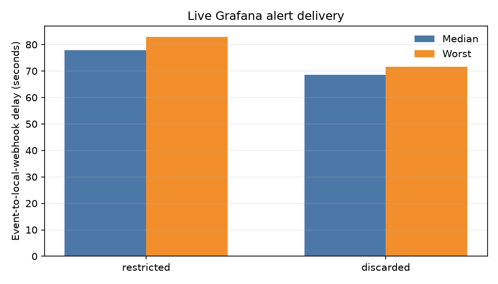

# Zero Trust SSH Gateway

A Windows-hosted SSH gateway that checks commands during a session and adjusts access as risk changes. Docker Desktop runs the gateway and an isolated Ubuntu target; the target has no published SSH port.

## What it does

- Authenticates users with SSH keys and limits repeated failed logins.
- Scores each command with named rules and per-user command-sequence profiles.
- Allows, restricts, or discards sessions; requests TOTP for high-cost commands.
- Records decisions for review and explains them with session replay.
- Quarantines profile updates and accepts administrator feedback.
- Sends telemetry to Grafana and Loki, with local alert capture and optional Brevo email.

## Start

Follow the [Windows quick start](docs/quickstart.md). The measured results are in [Results](docs/results.md); scope limits are in [Limits](docs/limitations.md).

This MVP has **35 passing tests**.

More: [key management](docs/key-management.md) · [operations](docs/operations.md) · [external data](data/EXTERNAL_DATA.md) · [evaluation artifacts](eval/results/README.md)
