# Evaluation results

The included charts and summary files describe the runs below. Per-session records, audit logs, and downloaded datasets are generated locally and are excluded from Git. The longer evaluation scripts are under `eval/scripts/`.

## Schonlau command blocks

The benchmark trains each user profile on the first 5,000 clean commands. Later 100-command blocks are split by whole block: every fifth block is validation and the remaining 80 blocks per user are held out. Thresholds and model parameters use validation data only.

| Model | AUC | Detection / observed FPR at 1% | at 5% | at 10% |
|---|---:|---:|---:|---:|
| Global second-order | 0.467 | 2.7% / 1.3% | 10.7% / 5.2% | 15.5% / 10.2% |
| Per-user frequency | 0.833 | 31.6% / 1.8% | 40.6% / 5.8% | 56.7% / 10.5% |
| Per-user second-order | 0.858 | 6.4% / 0.8% | 39.0% / 5.2% | 67.9% / 11.2% |
| Interpolated per-user | 0.868 | 23.0% / 1.3% | 58.3% / 6.2% | 67.9% / 11.0% |
| Per-user/global likelihood ratio | **0.914** | 7.5% / 1.0% | 56.7% / 5.5% | **78.1% / 10.9%** |

The ROC graph compares the command models across thresholds; the table shows detection alongside observed held-out false positives at validation-selected thresholds.

After preparing the local Schonlau files as described in [external data](../data/EXTERNAL_DATA.md), reproduce the run with `python eval/scripts/evaluate_schonlau.py`.

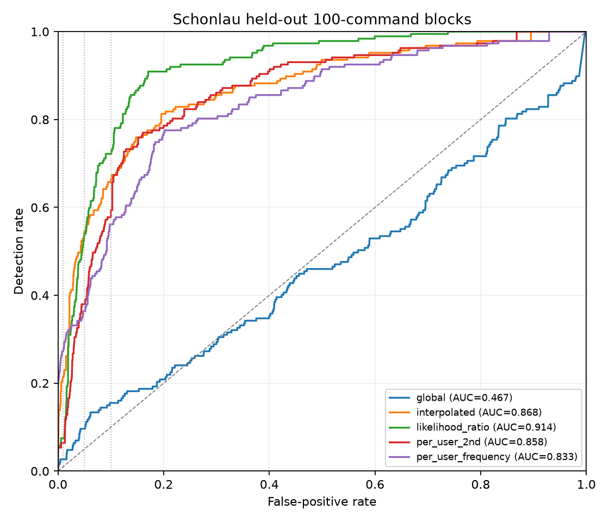

## Cowrie temporal holdout

The six-day COW160 set contains 276,512 sessions. Each held-out day uses an attacker profile trained on earlier days and a threshold selected with separate synthetic benign validation sessions.

| Held-out day | Earlier training days | Cowrie detected | Synthetic benign false positives |
|---|---:|---:|---:|
| 2025-06-28 | 1 | 99.9% | 2.9% |
| 2025-06-29 | 2 | 99.7% | 3.7% |
| 2025-06-30 | 3 | 99.9% | 3.7% |
| 2025-07-01 | 4 | 100.0% | 3.7% |
| 2025-07-02 | 5 | 100.0% | 4.4% |

This measures temporal matching on the downloaded honeypot set with synthetic benign comparisons.

After fetching and converting the days in [external data](../data/EXTERNAL_DATA.md), run `python eval/scripts/evaluate_cowrie_multiday.py`.

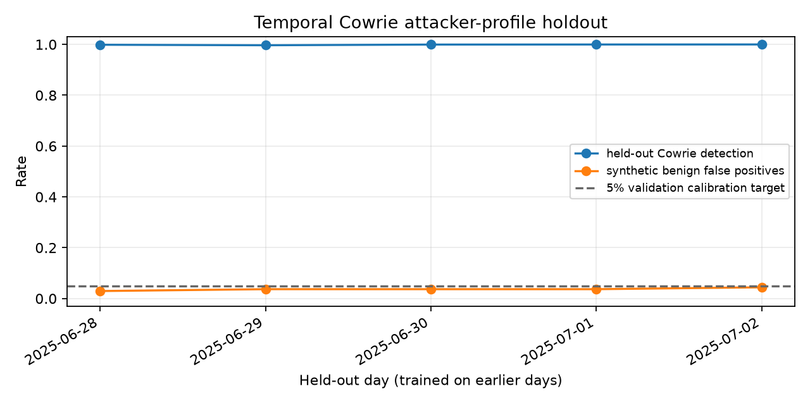

## Synthetic session model comparison

The fixed-seed run generated 880 sessions with session-level train, validation, and test splits.

| Model | Held-out detection | Held-out false positives |
|---|---:|---:|
| Per-user | 66.7% (16/24) | 5.9% (8/136) |
| Global | 100% (24/24) | 4.4% (6/136) |

It measures how these profiles separate the generated benign and hijack sessions at thresholds chosen on 136 synthetic validation sessions.

Reproduce with `python data/generate_sessions.py` followed by `python eval/scripts/evaluate.py`.

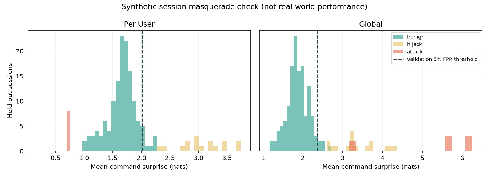

## Cold start

Five-seed mean ± sample standard deviation for 0, 5, 20, or 100 training sessions per role:

| Training sessions per user | Hijack detection | Benign false positives |
|---:|---:|---:|
| 0 | 66.3% ± 18.0% | 6.5% ± 1.8% |
| 5 | 93.8% ± 4.4% | 4.7% ± 2.1% |
| 20 | 97.5% ± 3.4% | 4.4% ± 1.5% |
| 100 | 100% ± 0% | 6.0% ± 2.1% |

The zero-session case uses pooled traffic from other roles as a prior because the generator has one identity per role.

Reproduce with `python eval/scripts/evaluate_cold_start_repeated.py`.

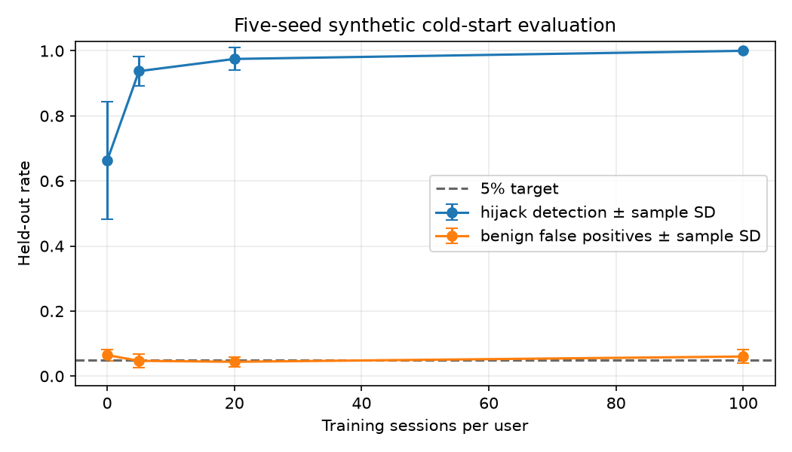

## Drift and learning

Across ten generator seeds, clear drift produced 100% false positives for static and automatic-update arms, versus 87.5% with administrator feedback (95% seed-bootstrap interval 77.5–97.5%). Gradual drift produced 60% for static and automatic updates, versus 57.5% with feedback (interval 42.5–72.5%). Automatic clean-session promotion alone did not resolve this generated drift. Feedback labels use ground truth.

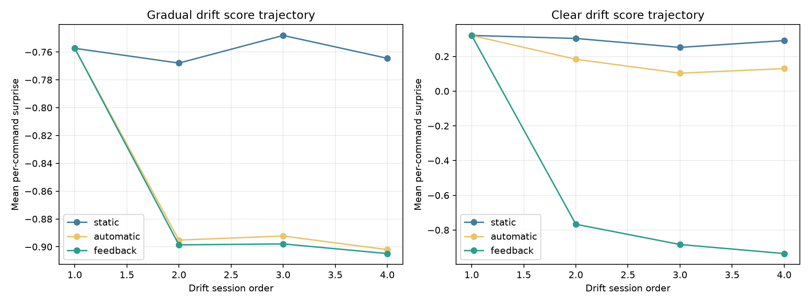

Reproduce with `python eval/scripts/evaluate_drift.py`.

## Policy and replay checks

Deterministic checks exercised restricted decisions, TOTP step-up, full-session counterfactual replay, and poisoning eligibility. The figure reports the scripted mechanism checks.

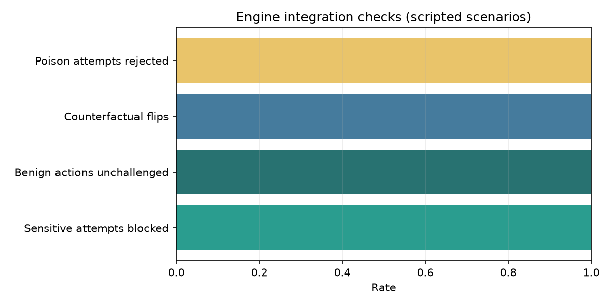

The redacted image below is rendered from a recorded clean demo event; it omits identity and session fields.

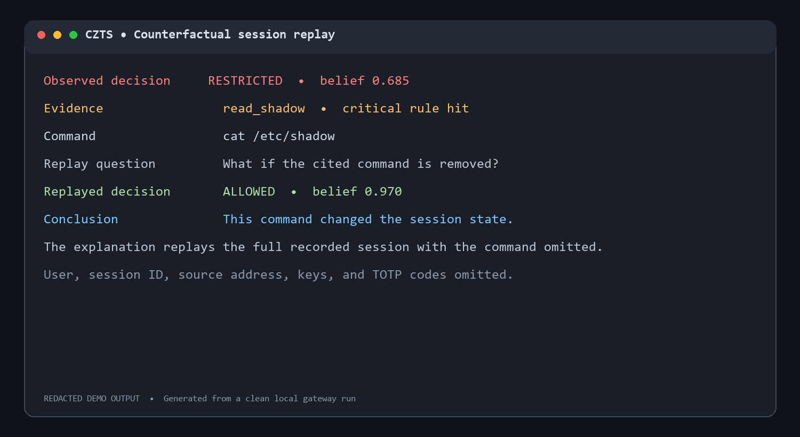

Run the scripted checks with `python eval/scripts/evaluate_stage16.py`.

## Live SSH and alert measurements

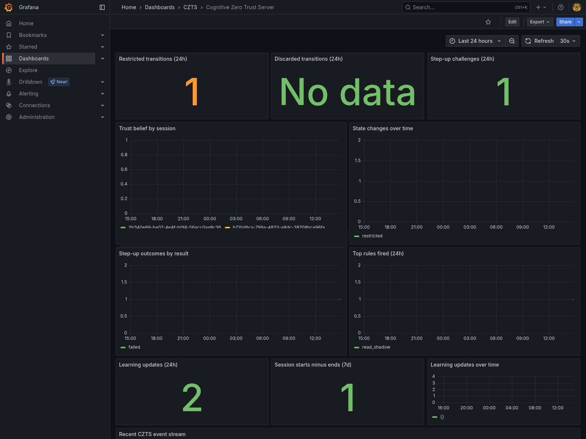

The session-ID legend is redacted from this screenshot.

The PTY capture check used 30 SSH sessions: 20 ordinary command lines and 10 lines containing arrow keys or Tab. Ordinary lines matched exactly in 20/20 cases; all 10 awkward lines failed closed and no test payload was executed. A separate alternate-screen check recorded start/end transitions and trust decay over an observed 0.205 seconds. The SSH setup-plus-`whoami` benchmark measured a median added 1,478.6 ms; the direct and gateway probes ran in different network contexts, so this is not a controlled overhead estimate.

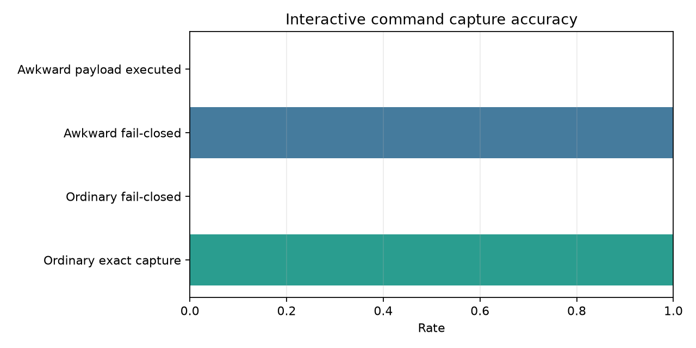

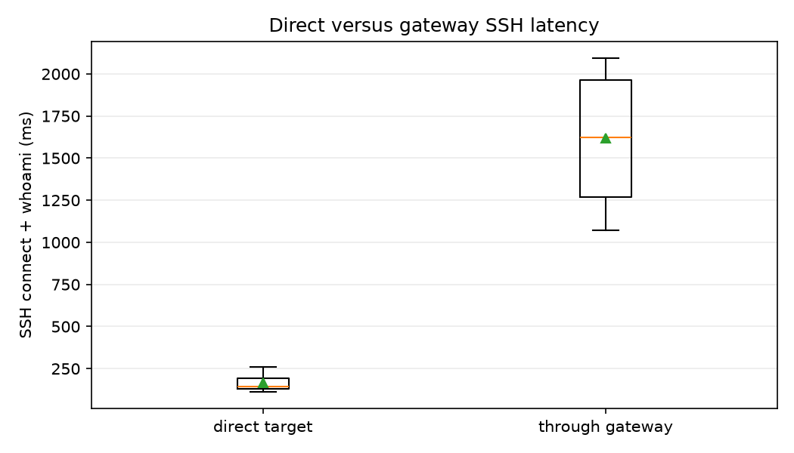

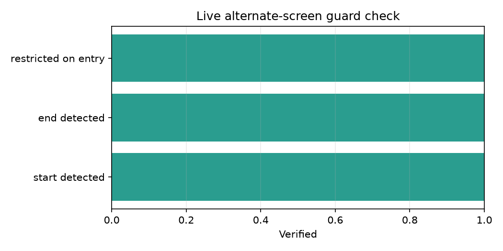

A live gateway-path smoke test created five restricted and five discarded sessions. A separate alert-delay measurement recorded event-to-local-webhook medians of 77.820 seconds for restricted events (10 observations) and 68.554 seconds for discarded events (5 observations); worst observations were 82.942 and 71.601 seconds. Email delivery was confirmed by hand but not timed per alert.

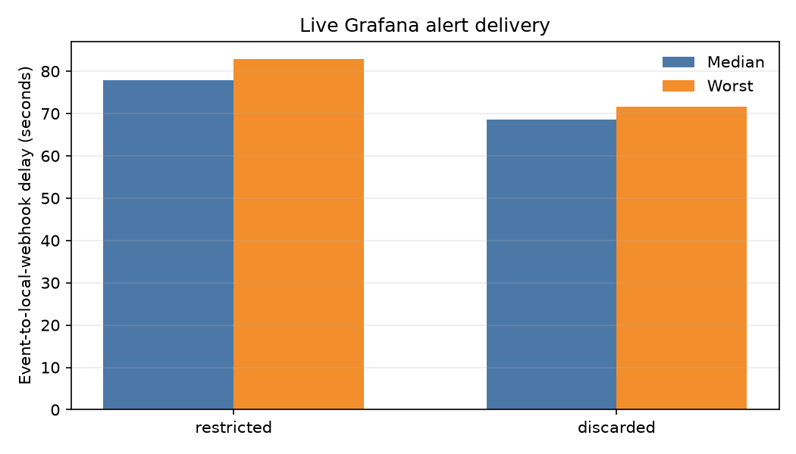

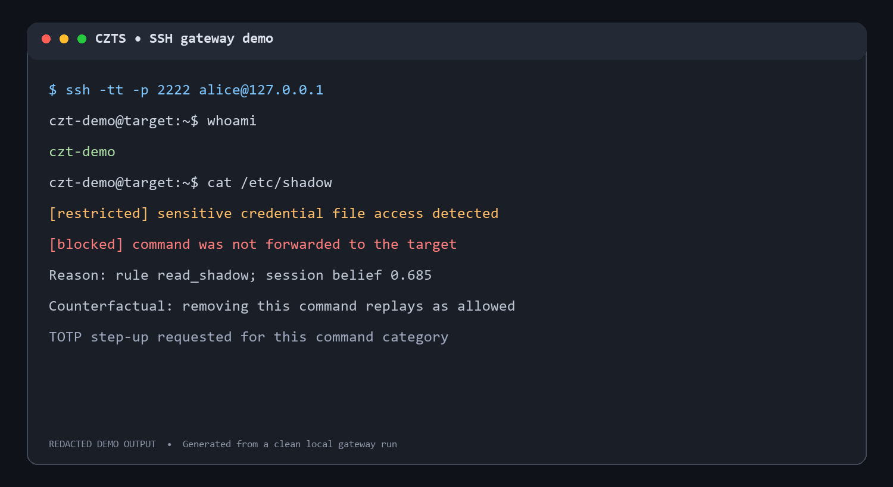

The image is a redacted rendering of the clean quick-start demo output, not a raw desktop capture.

The live alert run used `python eval/scripts/measure_live_alert_sessions.py --count 5` with the Docker stack running. It creates ten gateway sessions and sends restricted/discarded notifications through the configured alert route. For SSH overhead and typed-line capture, use `python eval/scripts/measure_latency.py --iterations 10` and `python eval/scripts/measure_capture.py`.

The direct-versus-gateway SSH benchmark includes connection setup and `whoami`; the direct probe runs inside Docker while the gateway probe starts on Windows, so the comparison includes different network contexts.
